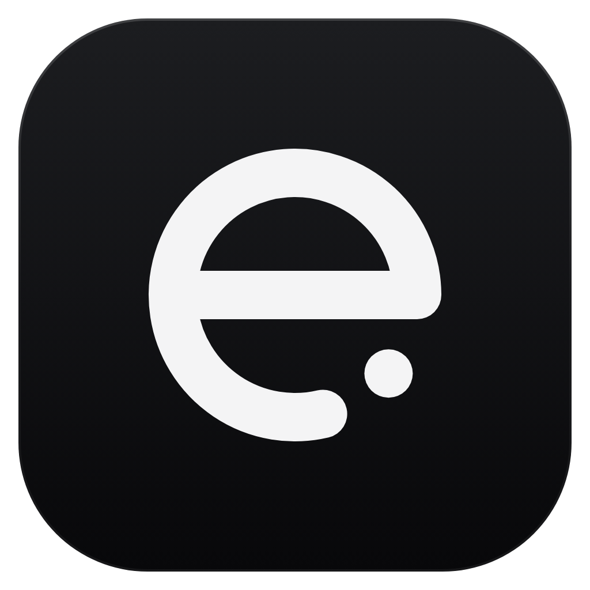
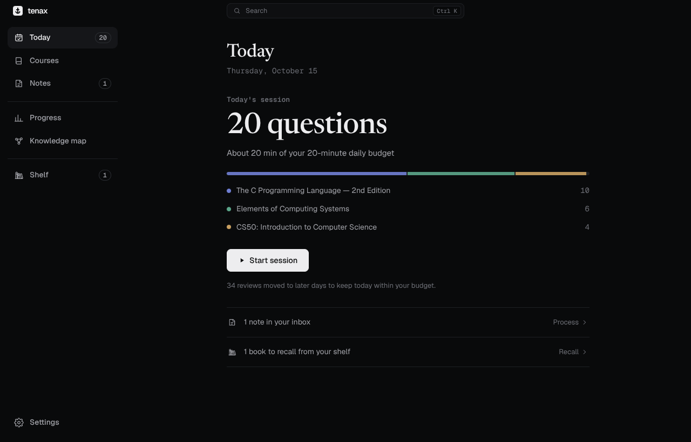
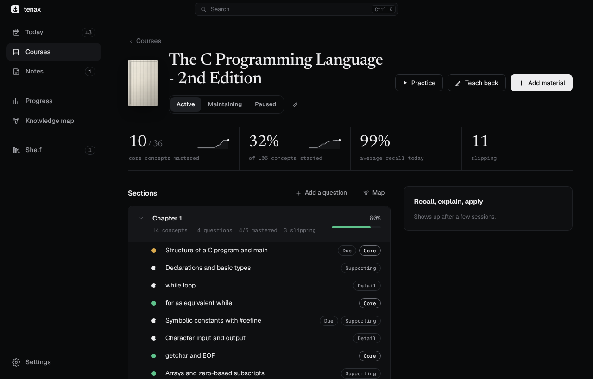
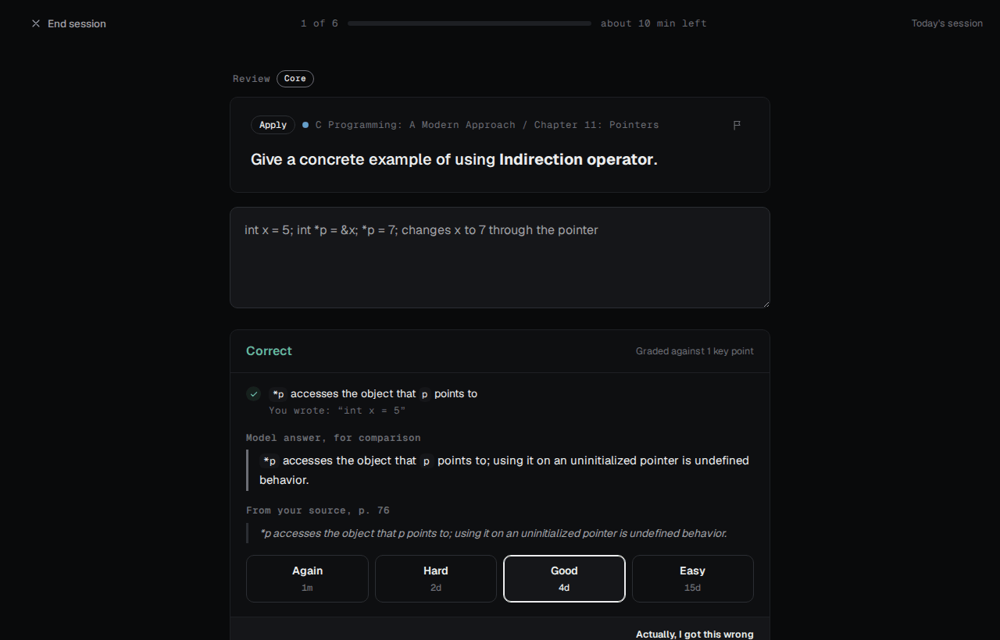
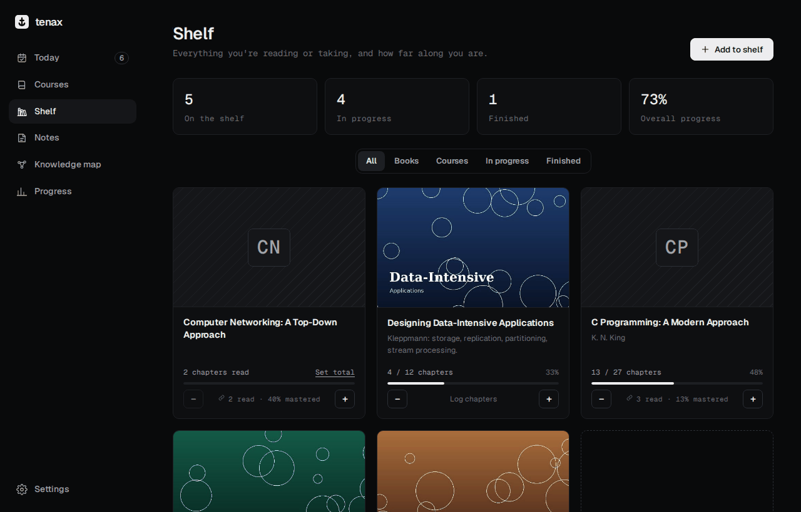
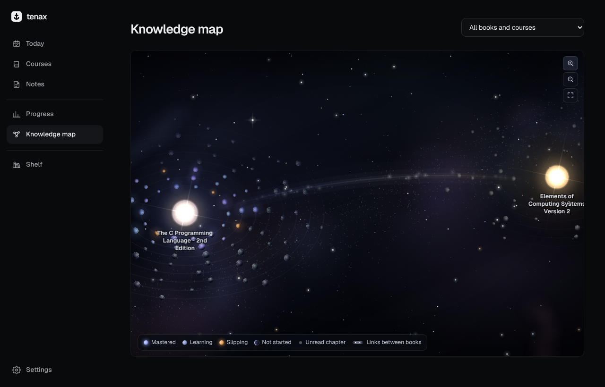

<p align="center">
  
</p>

<h1 align="center">Tenax</h1>

<p align="center">
  A desktop study app for keeping what you learn: a short review each day, questions worth answering,<br>
  and your books and courses on one shelf.
</p>

<p align="center">
  <a href="https://github.com/UnoVex11223/Study-Application/releases/latest"><b>Download for Windows</b></a>
</p>

<p align="center">
  <a href="https://github.com/UnoVex11223/Study-Application/releases/latest"></a>
  
  
  
</p>



*Tenax* is Latin for "holding fast". The app is built for studying several subjects at once without the reviews piling up: you add material as you work through it, Claude turns it into questions, and a scheduler decides what's worth reviewing each day within the time you give it.

## What it does

- **A daily session that fits your time.** You set a daily budget, for example 20 minutes. Reviews are scheduled per concept with FSRS, and new material is let in only as fast as your budget allows, so the load stays level instead of spiking.
- **Questions worth answering.** Add a chapter as text or PDF. Claude pulls out the concepts that matter, writes recall, explain, distinguish and apply questions, and a second pass reviews every question and throws out weak ones before you see them.
- **Written answers, graded.** You answer in your own words. Claude checks each key point, quotes what you wrote, and shows the model answer and the passage from your source.
- **Whole books from a PDF.** Tenax reads the table of contents, imports every chapter in the background, and keeps unread chapters locked until you mark them read.
- **Notes.** Jot down things you learn outside a course. Each note becomes new concepts, extra questions on something you already study, or nothing if it isn't worth remembering, without inflating a course's totals.
- **Shelf.** Your reading, textbooks and courses standing on shelves as 3D books, each kind with its own tab. Tenax courses show up on their own; anything else you add by hand, with a cover and progress. Books you read for fun also get star ratings and a few notes in your own words (what it's about, what you thought, ideas worth keeping), and every so often Tenax asks what you remember before showing your notes again: a few days later, then further apart each time it sticks.
- **Knowledge map.** A sky of solar systems: each book is a sun with its name beneath it, its chapters are orbits, and its concepts are planets going round, lit by their sun and glowing once you master them. Books that share ideas are joined by a stream of light; point at a planet to see its own links. Names come in as you zoom. Point at a planet and the sky stops; click it to glide over and open it.
- **Every computer, one library.** Sync through a folder your cloud drive already syncs (OneDrive, Dropbox, Google Drive). No server, no account.

| | |
|---|---|
|  |  |
|  |  |

## Getting started

1. Download `Tenax-Setup-<version>.exe` from the [latest release](https://github.com/UnoVex11223/Study-Application/releases/latest) and run it. The app isn't code-signed, so Windows SmartScreen asks the first time: choose **More info → Run anyway**.
2. Paste an Anthropic API key in **Settings → Anthropic API key** (the **Create a key** button there opens the Anthropic Console). It's encrypted with your Windows account and never leaves your computer except in calls to the API.
3. Create a course, or import a book, and add your first chapter.

Tenax updates itself: new releases download in the background and install the next time you close it.

### Using it on more than one computer

On each computer, go to **Settings → Sync across computers** and choose the same folder (one click for OneDrive). Each computer writes its own compressed copy there and merges in the others' copies, record by record, so studying on the desktop in the morning and the laptop at night just works. The API key and book PDFs stay on each computer. The files are small: a few MB even for a large library.

### What it costs

Tenax is free; the AI calls are billed to your API key. Book imports go through Anthropic's Batch API at half price by default, prompts are cached, and grading uses a faster, cheaper model than question writing.

## Your data

Everything is stored locally in one file, with an automatic daily backup (the last 14 are kept; **Settings → Your data**). You can export or restore a backup at any time. Tenax only talks to the Anthropic API (the text you study and your answers, to write and grade questions) and to GitHub (to check for updates).

## Building from source

Requires Node.js 22 or later.

```bash
git clone https://github.com/UnoVex11223/Study-Application.git
cd Study-Application
npm ci
npm run electron   # run in development
npm test           # unit tests
npm run lint
npm run dist       # build a Windows installer into release/
```

**Releases** are automatic: bump `version` in `package.json` and push. The [release workflow](.github/workflows/release.yml) runs the tests, builds the installer on Windows and publishes it, and installed copies pick it up.

### How it's put together

Electron main process (`electron.cjs`: storage, Claude calls with structured outputs, PDF reading, backups, updates) and a React 19 + Vite interface (`src/`). The core logic (scheduling, planning, mastery, the quality gate, sync merging) is plain JavaScript under `src/lib/` with unit tests in `tests/`.

[APP-CONTEXT.md](APP-CONTEXT.md) explains how everything works in detail: the daily planner, question quality, grading, mastery, book imports, notes, the shelf, sync and costs.

## History

Tenax started as **AeroFlash**, a flashcard app, and was rebuilt around concepts, graded written answers and a daily time budget. **AeroShelf**, a separate tracker for books and courses, became the Shelf page.
